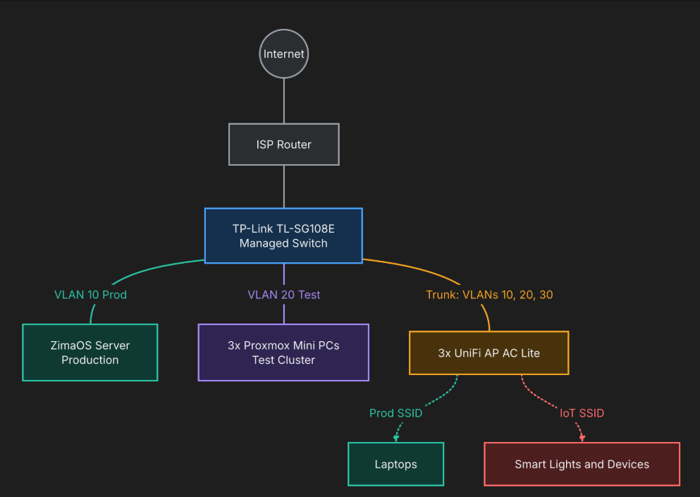

# Homelab-Handbook
 
Welcome to my homelab. This repository is the written record of how it's built, why it's built that way, and (for the test environment) how I set up the services running in it.
 
My homelab is split into three zones: a **production** environment that the household depends on, a **test** environment where I break things on purpose, and an **IoT** zone for devices I don't fully trust. This page explains each zone, how they're separated, and how traffic moves between them.
 
---
 
## Contents of this README
 
- The two environments
- Why production isn't documented here
- Hardware overview
- Network design
- Why VLANs?](#why-vlans
- How traffic flows
- What's in this repo
---
 
## The two environments
 
### Production: ZimaOS
 
A single PC running [ZimaOS](https://www.zimaspace.com/zimaos), serving the people in my home. The goal for the production environment is simple: **easy to fix, minimal downtime**.
 
| | |
|---|---|
| **CPU** | Intel Core i5-10500 |
| **RAM** | 16 GB |
| **Boot drive** | 256 GB SSD |
| **Storage** | 2 x 4 TB HDD in RAID 1 |
 
**Services running:**
 
| Category | Services |
|---|---|
| Media & games | Jellyfin, RomM |
| Photos & files | Immich, network file share, Syncthing |
| Home & household | Home Assistant, Mealie |
| Network & access | PiHole, Tailscale |
| Monitoring | Uptime Kuma, Grafana, Scrutiny, RackPeek |
| Game servers | Crafty |
 
### Test: Proxmox VE cluster
 
Three identical HP Elitedesk 800 G2 mini PCs running [Proxmox VE](https://www.proxmox.com/en/proxmox-virtual-environment/overview) as a three-node cluster with quorum. This is where I try new services, practise real-world infrastructure skills, and test changes before they go anywhere near production. **This is the part of the lab this handbook documents.**

| | |
|---|---|
| **CPU** | Intel Core i5-6500T |
| **RAM** | 16 GB |
| **Boot drive** | 256 GB SSD |

---
 
## Why production isn't documented here
 
ZimaOS is the production platform *because* it's boring to document.
 
Most of production is installed from the app store in a few clicks, and there's very little to write down that the app itself doesn't already make obvious. I chose it deliberately:
 
- **Easy to use:** installing and updating services is an app-store experience.
- **Easy to troubleshoot:** when something breaks, there are few moving parts to check.
- **Fast to recover:** the people using these services just want them to work, so a fix should take minutes rather than an evening of debugging.

A step-by-step guide for a one-click install would be boring. The interesting, document-worthy work happens in the test environment, so that's where this handbook focuses. If something in production ever becomes non-trivial (custom config, unusual networking), it'll get a page here too.
 
---
 
## Hardware overview
 
| Device | Qty | Role |
|---|---|---|
| PC (i5-10500, 16 GB RAM, 256 GB SSD + 2 x 4 TB HDD RAID 1) | 1 | Production (ZimaOS) |
| HP Mini PC (I5-6500T, 16GB RAM, 256 GB SSD) | 3 | Test (Proxmox VE cluster) |
| ISP router | 1 | Internet gateway |
| TP-Link TL-SG108E | 1 | 8-port managed switch |
| Ubiquiti UniFi AP AC Lite | 3 | Wi-Fi, one SSID per VLAN |
| Smart lights | 5 | IoT |
| Other smart devices | 3 | IoT |
| Laptops | 3 | Trusted client devices |
 
---
 
## Network design
 
The network is divided into three VLANs.
 
| VLAN | Name | Purpose | Example (dummy) subnet |
|---|---|---|---|
| 10 | **Prod** | ZimaOS server, trusted laptops | `192.168.10.0/24` |
| 20 | **Test** | Proxmox cluster and anything I'm experimenting with | `192.168.20.0/24` |
| 30 | **IoT** | Smart lights and other smart devices | `192.168.30.0/24` |
 
The TL-SG108E carries the VLANs between devices. The three UniFi APs broadcast a separate SSID for each VLAN, so a device ends up in the right zone depending on which network it joins.
 
---
 
## Why VLANs?
 
Each zone exists to contain a different kind of risk.
 
**Test is separated from Prod** so experiments can't take down things people rely on. A misconfigured DHCP server, an IP conflict, or a runaway script on a Proxmox VM stays inside the test VLAN. Production keeps serving media and photos regardless of what I'm breaking.
 
**IoT is separated from everything else** because smart devices are the least trustworthy things on the network. They're rarely patched, often talk to cloud services I can't inspect, and are a common foothold for attackers. Keeping them on their own VLAN means a compromised bulb can't reach my laptops or my photo library.
 
**Prod is kept as a stable, trusted core.** It has the fewest things connected to it and the most predictable traffic, which is exactly what you want from the environment people depend on.
 
---
 
## How traffic flows
 

 
### Normal day-to-day flow
 
1. **Laptops** join the Prod Wi-Fi. They get an address on the Prod VLAN and reach Jellyfin, Immich, the file share and Home Assistant on the ZimaOS server directly.
2. **DNS** queries go to PiHole on the ZimaOS server, which filters ads and trackers before forwarding upstream.
3. **Internet-bound traffic** leaves via the switch to the ISP router and out to the internet.
4. **IoT devices** join the IoT Wi-Fi. They can reach the internet and, where needed, Home Assistant so it can control them. They can't initiate connections to the Prod or Test VLANs.
5. **Test VMs** live on the Test VLAN and have internet access for pulling packages and images, but are isolated from Prod.
### Remote access
 
Tailscale runs on the production server, so I can reach services from outside the house without opening any ports on the ISP router.
 
### Monitoring
 
Uptime Kuma, Grafana, Scrutiny (drive health) and RackPeek run on the production server, so I get alerts and dashboards for the lab itself.
 
---
 
## What's in this repo
 
This handbook documents the **test environment**.
Each service guide aims to cover what it is, why I run it, how I installed it, and what went wrong along the way.
